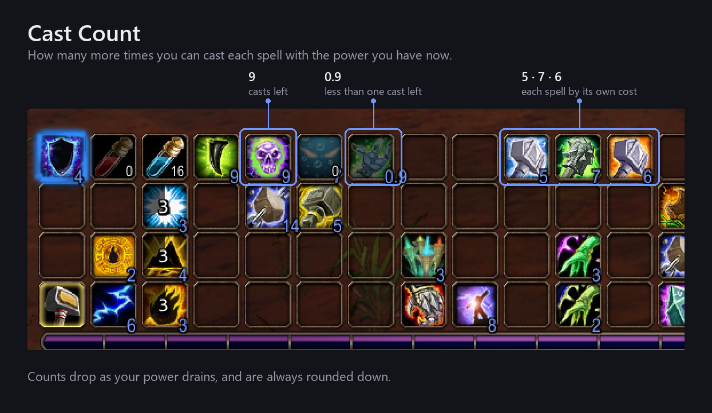

# Cast Count

A World of Warcraft: Forever addon that shows, in the top-left corner of each action button, how many times you can cast that spell with your current power.



*Shown with a custom color and position, and Decimal places set to "Only below 1". By default the number is white, in the top-left corner.*

Supports the Blizzard action bars, Bartender4, Dominos and ElvUI.

## How it works

Each count is your current power divided by the spell's cost, rounded down. With 1000 mana, a 50-mana spell shows 20 and a 100-mana spell shows 10. A count of 0 means you can't afford the spell right now. Rounding down means 0.9 casts of power shows 0, not 1. Set Decimal places to see the fraction.

- **What gets a count:** spells, and macros that cast a spell. Items, empty slots and spells with no cost stay blank.
- **Power types:** mana, rage, energy, focus and runic power. Each button counts against the power type its own spell costs, so a druid's bars stay right across forms.
- **Spells with several costs:** the first cost listed for the spell is used.
- **When it updates:** the counts change on every power update, whether you're casting, regenerating, or your max power changes. The addon reads your bars again when you drag a spell onto them, turn a bar page, change stance or form, learn spells or talents, change gear, edit a macro, or leave combat.
- **In combat:** sometimes the client hides a spell's cost in combat. When it does, the button keeps the last cost it read, and that cost is read again when combat ends.

### Hidden power

Forever doesn't let addons read your exact power. Cast Count can't do the division itself, so it gives the client a curve that maps your power fraction (0 to 1) to a number of casts for each distinct cost. The client evaluates that curve through `UnitPowerPercent`, and the result goes straight to the button label without the addon ever seeing it. The curve builds in the rounding down, so a hidden count matches what you'd see if the power were readable. There is one exception: with "Only below 1", a hidden count shows 0.9 instead of .9.

### CPU cost

- Action slots and spell costs are read only when the bars change. A burst of changes, like swapping a whole bar, is merged into one pass 0.2 seconds later.
- A power change reads no slots and no costs. It works out one count for each distinct spell cost of that power type, and when power is readable, only changes labels whose text is different.
- Turning off "Show cast counts" hides the numbers and stops all of this work.

## Install

Copy this folder into `World of Warcraft\_forever_\Interface\AddOns\CastCount` and `/reload`. Turn off MissingPower, which draws its count in the same corner.

## Options

Open Esc > Options > AddOns > Cast Count.

| Option | What it does |
| --- | --- |
| Show cast counts | Turns the numbers on or off. Off hides them and stops all work until you turn it back on. |
| Decimal places | 0, 1 or 2 decimals (3, 3.7, 3.75), or "Only below 1" (whole numbers, and a tenth such as .9 below 1 cast), still rounded down. Default 0. When the client hides your power, "Only below 1" shows 0.9 instead of .9. |
| Font | Font of the number. Default Arial Narrow. Lists every font registered with LibSharedMedia when an addon that embeds it is loaded (Bartender4, Questie, ...), else the four built-in fonts. A saved font whose file is gone falls back to Arial Narrow. |
| Color | Color of the number. Default white. |
| Font size | Height of the number, 6 to 24. Default 12. |
| Horizontal offset | Pixels from the button's left edge, 0 to 40. Default 2. |
| Vertical offset | Pixels down from the button's top edge, 0 to 40. Default 2. |

Settings are saved per account in `CastCountDB`.

## Debug

`/castcount` prints how many buttons were found, how many have a cost, whether power is hidden, and what the client returns for the first three filled buttons.

## Type check

`.\scripts\check.ps1` checks `CastCount.lua` with [lua-language-server](https://github.com/LuaLS/lua-language-server) against [Ketho's WoW API annotations](https://github.com/Ketho/vscode-wow-api). The first run downloads both, at the versions pinned in the script, into `.tools/` (gitignored). It fails on unknown globals and on calls with missing, extra or wrongly typed arguments. It does not catch a misspelled method on a frame, because the annotations type `CreateFrame`'s result as a plain table too. The annotations follow the retail API, which Forever shares for the most part.

Editors that use lua-language-server pick up the same settings from `.luarc.json` once the script has run.

To run it before every commit that touches a `.lua` file or `.luarc.json`, turn on the repo's hooks once per clone:

```
git config core.hooksPath .githooks
```

The hook checks the files on disk, not only what is staged.

## Verify in the simulator

Cast Count is checked in [wow-ui-sim](https://github.com/Osso/wow-ui-sim). Download its Forever build (`wow-ui-sim-<version>-forever-windows-x86_64.zip` from the releases page), unzip it, and point `WOW_SIM` at `wow-sim.exe` in a `.env` file at the repo root (gitignored):

```
WOW_SIM=C:\path\to\wow-ui-sim-forever\wow-sim.exe
```

`$env:WOW_SIM` and `-Sim` override the file.

Then, from this folder:

| Command | What it does |
| --- | --- |
| `.\scripts\sim.ps1 test` | Runs `tests/*.lua` headless. Fails on a failed test or on any Lua error raised in `CastCount.lua`, which the simulator's test runner alone does not count as a failure. |
| `.\scripts\sim.ps1 gui` | Opens the simulator window with Cast Count loaded and [scripts/sim-demo.lua](scripts/sim-demo.lua) applied: a mage at 1000 mana, Fireball in slots 1 and 3 (shows 20), Frostbolt in slot 2 (shows 10). |
| `.\scripts\sim.ps1 screenshot` | Renders that scene headless to `.sim/screenshot.png` (`-Output` to change it, `-Crop bar` for just the main action bar). |

`-Class Warrior` picks another class; `-Sim` overrides `WOW_SIM`. The script links this folder into a temp addons root as `CastCount`, so the checkout can have any name.

Claude Code sessions in this repo have a `sim-verify` skill ([.claude/skills/sim-verify](.claude/skills/sim-verify/SKILL.md)). It runs the tests, renders the action bar, and has Claude read the numbers off the image.

The simulator does not hide the player's power, so these checks cover the readable-power path only.
